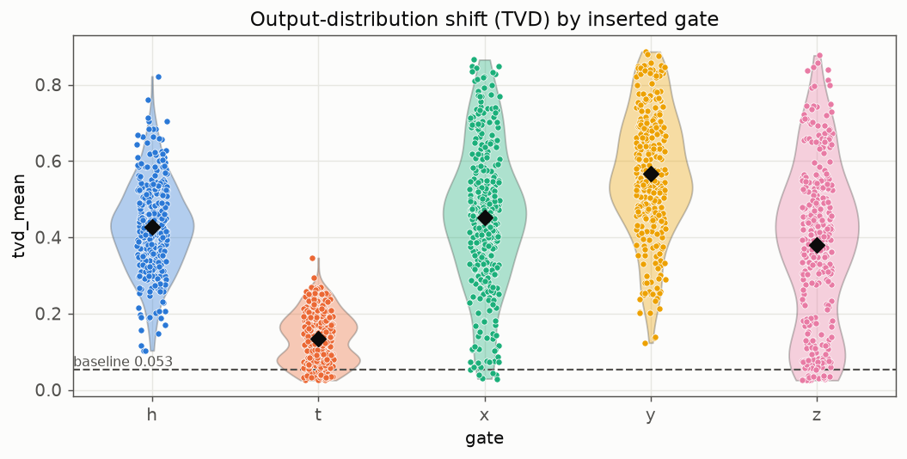
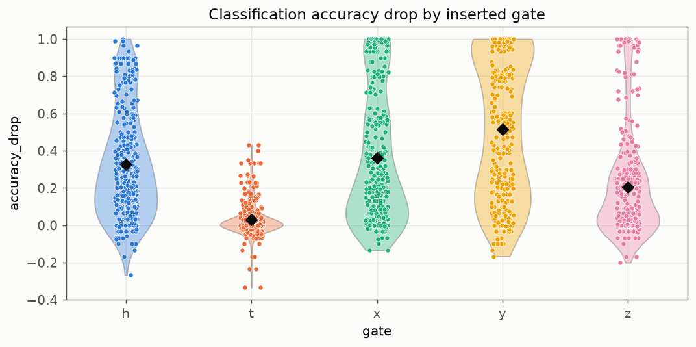
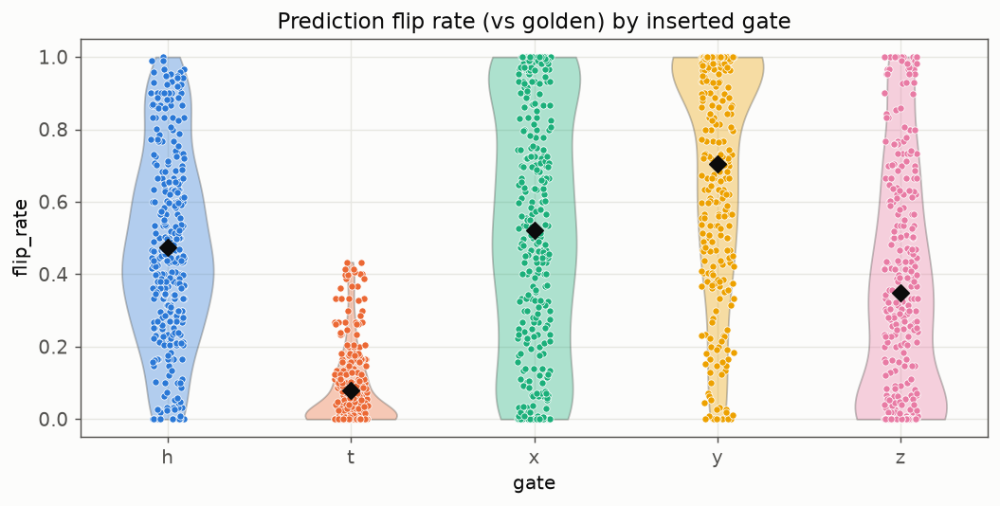
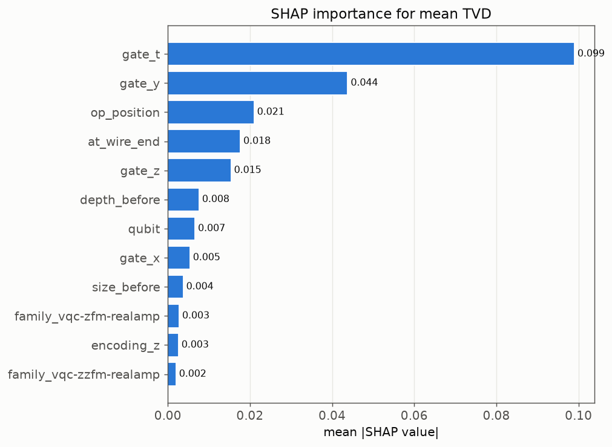
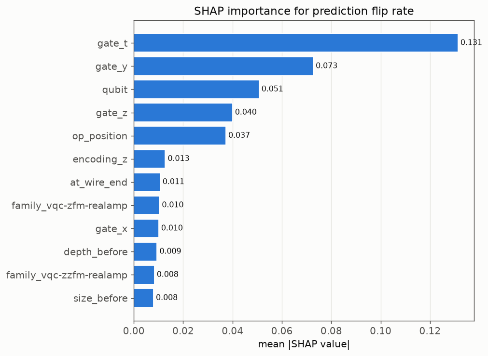
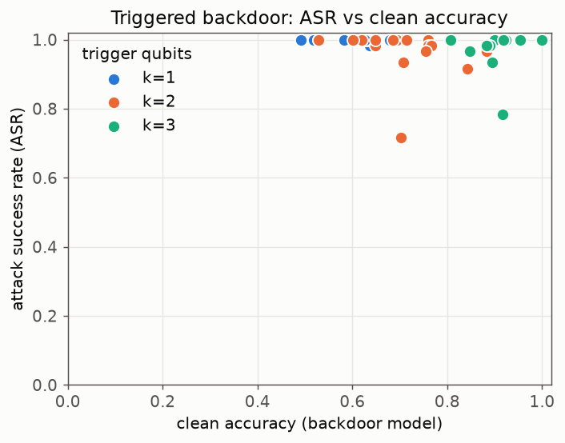
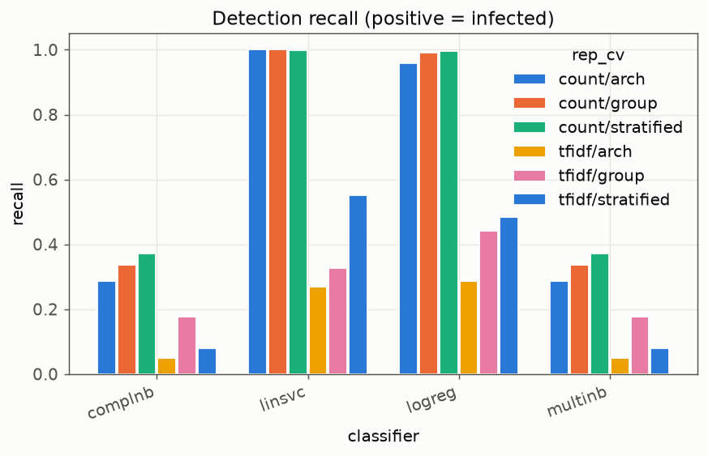
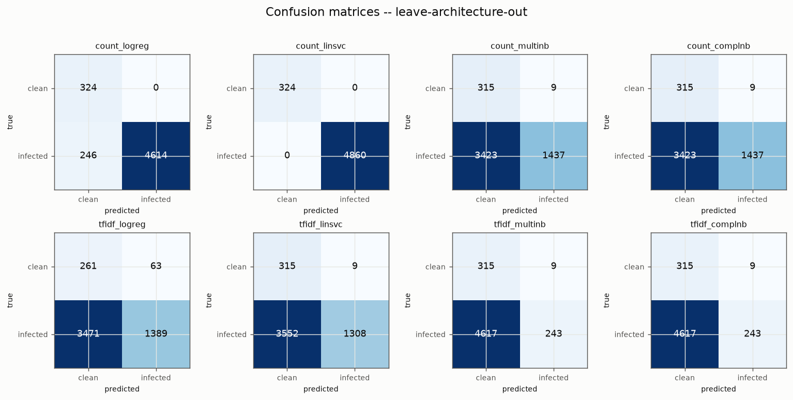

# qml-trojan-benchmark

[](LICENSE)
[](https://www.python.org/downloads/)
[](https://www.ibm.com/quantum/qiskit)

**Security of Quantum Machine Learning against trojan / backdoor insertion.**

A reproducible, laptop-scale benchmark that studies what happens when a compromised quantum
software-supply-chain component (a malicious Qiskit transpiler pass) inserts gates into an
already-trained **Variational Quantum Classifier (VQC)**. It bridges two research directions:
**(1) trojan detection in quantum circuits** and **(2) Quantum Adversarial Machine Learning (QAML)**.

The study asks three questions:

- **(a)** What is the behavioural and **classification-accuracy** impact of single-gate insertions in VQCs?
- **(b)** Can a **trigger** degrade/flip classification only for specific inputs while preserving the rest (a **backdoor**)?
- **(c)** Can simple **text classifiers** (BoW/TF-IDF + classical ML) over the exported QASM tell clean VQCs from infected ones?

> This repository deliberately imitates the methodology of the quantum-trojan sensitivity work
> (gate-insertion dataset, TVD/BC/BD metrics, violin/strip plots, a text-detection table) and adds
> QAML-specific metrics (clean accuracy, accuracy drop, and attack success rate for a triggered backdoor).

---

## Adversarial model (software supply chain)

A once-trusted optimization dependency — a Qiskit **transpiler pass** — is compromised and begins
**inserting operations during compilation** of an already-trained VQC. The attacker controls
**neither** the algorithm source, **nor** the cloud provider, **nor** the hardware. The **defender**
has access to the **golden** (clean) and **infected** compiled artifacts and to their measurements.

For the single-gate trojans this is implemented literally: the attack is a real
`qiskit.transpiler.TransformationPass` run inside a `PassManager`, so the infected circuit is produced
by the compilation flow itself — exactly as in the field. The triggered backdoor models the same
adversary but is assembled directly (feature map → detector → ansatz → conditional flip) rather than
emitted by a pass, and it is not unrolled to the clean gate basis.

---

## Method at a glance

| Stage | What it does |
|---|---|
| **Victim models** | Train golden VQCs: `{Z, ZZ}` angle encoding + `RealAmplitudes` ansatz, parity-expectation readout, over Iris / digits 0-vs-1 / Breast-Cancer (PCA to 2 or 4 qubits), 3 seeds. |
| **Trojan insertion** | A malicious pass inserts **one** gate `{H,T,X,Y,Z}` per variant in `random` / `idle` / `controlled` mode; 15 variants per model with full structural metadata. |
| **Triggered backdoor** | A conditional trojan (inverse-encoding detector + mid-circuit measured ancilla + classically controlled parity flip) that flips the class only under a trigger pattern. |
| **Sensitivity** | TVD / BC / BD over measured output distributions (512 shots × 15 reps, on 8 test inputs per model) **vs a golden-vs-golden sampling baseline**, plus clean accuracy, accuracy drop and **prediction flip rate**; SHAP over structural attributes. |
| **Detection** | QASM-as-text (BoW & TF-IDF, uni+bigrams) × {LogReg, MultinomialNB, ComplementNB, LinearSVC} × {GroupKFold by model, **GroupKFold by architecture** (leave-architecture-out), StratifiedKFold}; full metric suite + confusion matrices. |

The victim/model architecture, the metrics, and every design decision are explained in depth, in
Portuguese, in [`docs/explicacao.md`](docs/explicacao.md).

---

## Installation

Requires **Python ≥ 3.10** (developed on 3.12), CPU only.

```bash
python -m venv .venv
# Windows:  .venv\Scripts\activate
# Linux/Mac: source .venv/bin/activate
pip install -r requirements.txt
pip install -e .          # installs the `qmltrojan` package
```

All dependency versions are pinned in [`requirements.txt`](requirements.txt).

---

## Reproducing the results

```bash
# Validate the whole pipeline end to end in a few minutes:
python scripts/run_all.py --quick

# Full benchmark (~2.5 h on a laptop CPU: exp1 training alone ≈ 1.7 h,
# exp2 ≈ 27 min, exp3 ≈ 10 min, exp4 ≈ 3 min); writes to results/full/:
python scripts/run_all.py --config full
```

Run the stages individually with the same `--quick` / `--config full` flag:

```bash
python scripts/exp1_golden.py     --config full   # train golden VQCs, export QASM, clean accuracy
python scripts/exp2_trojans.py    --config full   # infect, sensitivity (TVD/BC/BD), accuracy drop, SHAP
python scripts/exp3_backdoor.py   --config full   # triggered backdoor: ASR vs clean accuracy
python scripts/exp4_detection.py  --config full   # text detection grid + confusion matrices
```

Run the tests and the didactic notebook:

```bash
pytest -m "not slow"          # fast unit tests
pytest -m slow                # end-to-end quick-pipeline test (a few minutes)
jupyter notebook notebooks/demo.ipynb
```

Outputs land in `results/<mode>/`: `golden/`, `infected/`, `backdoor/` (OpenQASM 3 files),
CSVs (`metadata`, `sensitivity`, `backdoor`, `detection_summary`, `inventory`, `errors`, `shap_*`),
and `figures/*.png`. Quick-mode outputs are git-ignored; full-mode outputs are versioned.

---

## Why OpenQASM 3?

A trained VQC is still a **parametric program**: weights are fixed numbers but data features are
run-time inputs. OpenQASM 2 cannot represent free parameters (`QASM2ExportError`), so each classifier
is exported as **OpenQASM 3** with features declared as `input float[64] _x_i_;`. Export/parse
round-trips are tested.

---

## Results

<!-- RESULTS:START -->

### 1. Clean accuracy of the golden VQCs

Trained **108** golden VQCs; mean clean test accuracy **0.840 ± 0.154**.

| dataset       |     z |    zz |
|:--------------|------:|------:|
| breast_cancer | 0.903 | 0.758 |
| digits01      | 0.985 | 0.816 |
| iris          | 0.993 | 0.585 |

### 2. Sensitivity (TVD) and accuracy impact

Across **1620** infected variants, mean TVD **0.392** vs a golden-vs-golden sampling baseline of **0.053**; mean accuracy drop **0.289**; mean prediction flip rate **0.426**. TVD is estimated on the first 8 test inputs of each model; accuracy and flip rate use the whole test split.

**By inserted gate:**

| gate   |   tvd_mean |   bc_mean |   bd_mean |   accuracy_drop |   flip_rate |
|:-------|-----------:|----------:|----------:|----------------:|------------:|
| h      |      0.426 |     0.829 |     0.2   |           0.328 |       0.473 |
| t      |      0.134 |     0.975 |     0.025 |           0.031 |       0.079 |
| x      |      0.452 |     0.793 |     0.272 |           0.362 |       0.523 |
| y      |      0.567 |     0.713 |     0.393 |           0.516 |       0.703 |
| z      |      0.38  |     0.834 |     0.21  |           0.206 |       0.349 |

**By insertion mode** (`at_wire_end` = fraction of insertions placed after the wire's last gate, i.e. right before measurement):

| mode       |   tvd_mean |   accuracy_drop |   flip_rate |   at_wire_end |
|:-----------|-----------:|----------------:|------------:|--------------:|
| controlled |      0.39  |           0.338 |       0.475 |         0     |
| idle       |      0.385 |           0.243 |       0.378 |         0.178 |
| random     |      0.4   |           0.286 |       0.424 |         0.067 |

**Diagonal gates (`Z`, `T`) by position:** right before measurement they commute with the Z-basis readout, so their TVD should sit at the sampling floor.

| at_wire_end   |   n |   tvd_mean |   tvd_baseline |   flip_rate |
|:--------------|----:|-----------:|---------------:|------------:|
| False         | 564 |      0.287 |          0.053 |       0.246 |
| True          |  84 |      0.056 |          0.055 |       0     |







**SHAP — top drivers of mean TVD:** `gate_t` (0.099), `gate_y` (0.044), `op_position` (0.021), `at_wire_end` (0.018), `gate_z` (0.015), `depth_before` (0.008)



**SHAP — top drivers of prediction flip rate:** `gate_t` (0.131), `gate_y` (0.073), `qubit` (0.051), `gate_z` (0.040), `op_position` (0.037), `encoding_z` (0.013)



### 3. Triggered backdoor: ASR vs clean accuracy

Conditional backdoor on the 4-qubit `z`-encoding models (18 models):

|   k_trigger |   asr |   clean_acc_backdoor |   clean_accuracy_drop |
|------------:|------:|---------------------:|----------------------:|
|           1 | 0.999 |                0.578 |                 0.353 |
|           2 | 0.969 |                0.707 |                 0.224 |
|           3 | 0.981 |                0.917 |                 0.014 |

Higher trigger width `k` keeps attack success high while reducing clean-accuracy leakage. The detector is a soft threshold (per trigger qubit it fires with probability sin²(x)), so with `k=1` every clean input with x₀ > π/4 is flipped; requiring `k` qubits multiplies these probabilities and makes the trigger more selective.



### 4. Text-based detection (golden vs infected)

Positive class = **infected**. Mean ± std across seeds. `group` = GroupKFold by base model; `arch` = GroupKFold by architecture (encoding × ansatz reps × qubits), i.e. the detector never sees the test circuit *structure* during training; `stratified` = StratifiedKFold.

| cv         | vectorizer   | classifier   | recall        | balanced_accuracy   | f1            | roc_auc       |
|:-----------|:-------------|:-------------|:--------------|:--------------------|:--------------|:--------------|
| arch       | count        | complnb      | 0.287 ± 0.199 | 0.627 ± 0.098       | 0.405 ± 0.262 | 0.820 ± 0.047 |
| arch       | count        | linsvc       | 1.000 ± 0.000 | 1.000 ± 0.000       | 1.000 ± 0.000 | 1.000 ± 0.000 |
| arch       | count        | logreg       | 0.958 ± 0.045 | 0.979 ± 0.023       | 0.978 ± 0.024 | 1.000 ± 0.000 |
| arch       | count        | multinb      | 0.287 ± 0.199 | 0.627 ± 0.098       | 0.405 ± 0.262 | 0.820 ± 0.047 |
| arch       | tfidf        | complnb      | 0.049 ± 0.098 | 0.513 ± 0.027       | 0.071 ± 0.142 | 0.820 ± 0.118 |
| arch       | tfidf        | linsvc       | 0.269 ± 0.156 | 0.623 ± 0.064       | 0.398 ± 0.194 | 0.904 ± 0.062 |
| arch       | tfidf        | logreg       | 0.286 ± 0.200 | 0.543 ± 0.044       | 0.395 ± 0.265 | 0.798 ± 0.102 |
| arch       | tfidf        | multinb      | 0.049 ± 0.098 | 0.513 ± 0.027       | 0.071 ± 0.142 | 0.820 ± 0.118 |
| group      | count        | complnb      | 0.336 ± 0.081 | 0.629 ± 0.042       | 0.495 ± 0.087 | 0.735 ± 0.053 |
| group      | count        | linsvc       | 1.000 ± 0.000 | 1.000 ± 0.000       | 1.000 ± 0.000 | 1.000 ± 0.000 |
| group      | count        | logreg       | 0.990 ± 0.009 | 0.995 ± 0.005       | 0.995 ± 0.005 | 1.000 ± 0.000 |
| group      | count        | multinb      | 0.336 ± 0.081 | 0.629 ± 0.042       | 0.495 ± 0.087 | 0.735 ± 0.053 |
| group      | tfidf        | complnb      | 0.177 ± 0.155 | 0.528 ± 0.041       | 0.269 ± 0.220 | 0.684 ± 0.046 |
| group      | tfidf        | linsvc       | 0.327 ± 0.063 | 0.598 ± 0.056       | 0.486 ± 0.067 | 0.808 ± 0.082 |
| group      | tfidf        | logreg       | 0.443 ± 0.062 | 0.564 ± 0.065       | 0.602 ± 0.058 | 0.655 ± 0.038 |
| group      | tfidf        | multinb      | 0.177 ± 0.155 | 0.528 ± 0.041       | 0.269 ± 0.220 | 0.684 ± 0.046 |
| stratified | count        | complnb      | 0.372 ± 0.100 | 0.579 ± 0.071       | 0.528 ± 0.105 | 0.652 ± 0.049 |
| stratified | count        | linsvc       | 0.999 ± 0.001 | 1.000 ± 0.001       | 1.000 ± 0.001 | 1.000 ± 0.000 |
| stratified | count        | logreg       | 0.997 ± 0.006 | 0.998 ± 0.003       | 0.998 ± 0.003 | 1.000 ± 0.000 |
| stratified | count        | multinb      | 0.372 ± 0.100 | 0.579 ± 0.071       | 0.528 ± 0.105 | 0.652 ± 0.049 |
| stratified | tfidf        | complnb      | 0.080 ± 0.071 | 0.489 ± 0.031       | 0.139 ± 0.110 | 0.583 ± 0.064 |
| stratified | tfidf        | linsvc       | 0.550 ± 0.058 | 0.636 ± 0.055       | 0.700 ± 0.047 | 0.731 ± 0.065 |
| stratified | tfidf        | logreg       | 0.485 ± 0.049 | 0.545 ± 0.065       | 0.640 ± 0.045 | 0.610 ± 0.056 |
| stratified | tfidf        | multinb      | 0.080 ± 0.071 | 0.489 ± 0.031       | 0.139 ± 0.110 | 0.583 ± 0.064 |






**Hard sub-problem — detecting the *in-vocabulary* `H` insertion only.** Golden circuits in this basis emit only `ry, p, cx, h`, so inserted `x/y/z/t` are out-of-vocabulary tokens and trivially flagged; the `H` insertion is the harder case because `h` already occurs in golden. It is still lexically easy: every golden circuit has exactly as many `h` as encoding phases `p(2*_x_i_)` (one of each per qubit per feature-map rep), and an inserted `h` breaks that count equality.

| cv         | vectorizer   | classifier   | recall        | balanced_accuracy   | f1            | roc_auc       |
|:-----------|:-------------|:-------------|:--------------|:--------------------|:--------------|:--------------|
| arch       | count        | complnb      | 0.022 ± 0.044 | 0.500 ± 0.000       | 0.031 ± 0.062 | 0.741 ± 0.064 |
| arch       | count        | linsvc       | 1.000 ± 0.000 | 1.000 ± 0.000       | 1.000 ± 0.000 | 1.000 ± 0.000 |
| arch       | count        | logreg       | 0.973 ± 0.038 | 0.986 ± 0.019       | 0.986 ± 0.020 | 0.998 ± 0.005 |
| arch       | count        | multinb      | 0.022 ± 0.044 | 0.500 ± 0.000       | 0.031 ± 0.062 | 0.741 ± 0.064 |
| arch       | tfidf        | complnb      | 0.022 ± 0.044 | 0.500 ± 0.000       | 0.031 ± 0.062 | 0.729 ± 0.037 |
| arch       | tfidf        | linsvc       | 0.232 ± 0.189 | 0.616 ± 0.095       | 0.331 ± 0.264 | 0.880 ± 0.100 |
| arch       | tfidf        | logreg       | 0.300 ± 0.242 | 0.539 ± 0.057       | 0.363 ± 0.280 | 0.737 ± 0.030 |
| arch       | tfidf        | multinb      | 0.022 ± 0.044 | 0.500 ± 0.000       | 0.031 ± 0.062 | 0.729 ± 0.037 |
| group      | count        | complnb      | 0.176 ± 0.221 | 0.504 ± 0.005       | 0.221 ± 0.274 | 0.596 ± 0.028 |
| group      | count        | linsvc       | 1.000 ± 0.000 | 1.000 ± 0.000       | 1.000 ± 0.000 | 1.000 ± 0.000 |
| group      | count        | logreg       | 1.000 ± 0.000 | 1.000 ± 0.000       | 1.000 ± 0.000 | 1.000 ± 0.000 |
| group      | count        | multinb      | 0.176 ± 0.221 | 0.504 ± 0.005       | 0.221 ± 0.274 | 0.596 ± 0.028 |
| group      | tfidf        | complnb      | 0.079 ± 0.122 | 0.500 ± 0.000       | 0.112 ± 0.174 | 0.606 ± 0.022 |
| group      | tfidf        | linsvc       | 0.212 ± 0.133 | 0.594 ± 0.060       | 0.323 ± 0.185 | 0.790 ± 0.053 |
| group      | tfidf        | logreg       | 0.431 ± 0.085 | 0.565 ± 0.066       | 0.558 ± 0.074 | 0.653 ± 0.040 |
| group      | tfidf        | multinb      | 0.079 ± 0.122 | 0.500 ± 0.000       | 0.112 ± 0.174 | 0.606 ± 0.022 |
| stratified | count        | complnb      | 0.199 ± 0.143 | 0.434 ± 0.044       | 0.279 ± 0.165 | 0.428 ± 0.034 |
| stratified | count        | linsvc       | 1.000 ± 0.000 | 1.000 ± 0.000       | 1.000 ± 0.000 | 1.000 ± 0.000 |
| stratified | count        | logreg       | 1.000 ± 0.000 | 1.000 ± 0.000       | 1.000 ± 0.000 | 1.000 ± 0.000 |
| stratified | count        | multinb      | 0.199 ± 0.143 | 0.434 ± 0.044       | 0.279 ± 0.165 | 0.428 ± 0.034 |
| stratified | tfidf        | complnb      | 0.085 ± 0.102 | 0.432 ± 0.030       | 0.128 ± 0.142 | 0.440 ± 0.061 |
| stratified | tfidf        | linsvc       | 0.372 ± 0.072 | 0.548 ± 0.065       | 0.504 ± 0.077 | 0.640 ± 0.063 |
| stratified | tfidf        | logreg       | 0.404 ± 0.080 | 0.469 ± 0.048       | 0.513 ± 0.079 | 0.520 ± 0.065 |
| stratified | tfidf        | multinb      | 0.085 ± 0.102 | 0.432 ± 0.030       | 0.128 ± 0.142 | 0.440 ± 0.061 |

<!-- RESULTS:END -->

---

## Honest discussion, limitations and negative results

- **The gate matters more than the mode.** Non-diagonal gates (`Y`, `X`, `H`) dominate the
  output-distribution shift (TVD), the accuracy drop and the prediction flip rate; the small phase
  gate `T` is almost inert (mean TVD ≈ 0.13, flip rate ≈ 0.08). SHAP over the structural attributes
  confirms that the **inserted-gate identity** is by far the strongest driver. This matches the
  physics: `T`/`Z` are diagonal in the `Z`-measurement basis. Mode barely moves the mean TVD
  (0.385–0.40), but it does move the flip rate: `controlled` (encoding/ansatz interface) 0.475 >
  `random` 0.424 > `idle` 0.378. Part of the `idle` gap is structural: 18% of `idle` insertions land
  after the wire's last gate (legitimate idle slots on wires that finished early, plus the random
  fallback on the 2-qubit `z` models, which have no idle slot at all).
- **Position decides whether a diagonal gate does anything.** Right before measurement, `Z`/`T`
  commute with the readout: their TVD is 0.056 against a 0.055 sampling floor and they flip **no**
  prediction. Anywhere earlier, the ansatz spreads them out (TVD 0.29, flip rate 0.25).
- **Correction to an earlier version of these results.** The first `idle` implementation counted the
  final barrier/measurement layers as "idle" slots (and counted the same slot once per idle layer),
  so **65%** of `idle` insertions landed right before measurement. That made `idle` look artificially
  weak and understated `Z` (mean TVD was 0.30, now 0.38). The `random` mode also gave the last
  position double weight. Both are fixed and tested, and the variants were regenerated; the golden
  models and the backdoor results are unchanged (exp3 reproduced bit-for-bit).
- **Accuracy drop understates impact; the flip rate does not.** A parity-flipping trojan maps
  accuracy `a` to `1 − a`, so on a weak model (e.g. `zz` on Iris, ≈ 0.59) a trojan that changes almost
  every prediction shows only a small "drop". The mean flip rate (0.43) is well above the mean
  accuracy drop (0.29).
- **The sampling baseline matters.** The golden-vs-golden TVD floor is ≈ 0.05; reporting trojan TVDs
  without it would overstate tiny effects. Every TVD in the table should be read against that floor.
- **Detection: near-perfect, even on unseen architectures, but for reasons that do not generalize.**
  `CountVectorizer` (BoW) + a **linear** model (LinearSVC / LogReg) detects infected circuits with
  recall ≈ 0.96–1.0 and ROC-AUC ≈ 1.0 under **every** scheme, including **leave-architecture-out**
  (`arch`, where the detector never sees the test circuit structure) and the in-vocabulary `H`-only
  sub-problem. Two lexical properties of this compile flow explain it, and both hold across all
  architectures: (1) `x/y/z/t` are out-of-vocabulary tokens a clean compile never emits; (2) every
  golden circuit has **exactly as many `h` as encoding phases `p(2*_x_i_)`**, so an inserted `h`
  breaks a count equality that a linear model on counts learns immediately. **TF-IDF and the
  Naive-Bayes variants are much weaker** (recall 0.18–0.44 under GroupKFold by model, 0.05–0.29
  leave-architecture-out), because TF-IDF down-weights the frequent structural tokens that carry the
  signal; their ROC-AUC under `arch` (up to 0.90) is much higher than their recall, i.e. the ranking
  survives but the decision threshold does not transfer to a new architecture. The takeaway is *not*
  "detection is easy in general" but "lexical detection is easy **when the clean compile is this
  regular**". An attacker who stays inside the clean vocabulary *and* preserves its count relations
  is not covered by this experiment, and on diverse real-world circuits a bag-of-tokens detector
  models no circuit **semantics**. We report recall together with balanced
  accuracy, F1 and ROC-AUC so a trivial "flag-everything" detector cannot hide.
- **Validation granularity.** GroupKFold by base model alone is optimistic here: the 12
  architectures each appear in 9 models (3 datasets × 3 seeds) whose QASM is structurally identical,
  which is why `group` and `stratified` scores were nearly the same. We therefore also report the
  leave-architecture-out `arch` scheme.
- **The backdoor works, but with honest caveats.** On the product `z` encoding, ASR ≈ 0.97–1.0 across
  trigger widths, and it becomes *stealthier* as `k` grows (clean-accuracy drop falls from ≈ 0.35 at
  `k=1` to ≈ 0.01 at `k=3`). The detector is a **soft threshold**, not an exact match: each trigger
  qubit returns to `|0⟩` with probability `sin²(x)`, and the ancilla fires with the product over the
  `k` qubits. With `k=1`, every clean input with `x₀ > π/4` (half the encoding range) is flipped,
  which is the leakage; larger `k` shrinks the firing region towards the all-`π/2` corner. Measuring a
  partially fired ancilla also partially collapses the data qubits, a second, smaller leakage source.
  On the entangling `zz` encoding the per-qubit detector is only approximate and the attack
  **degrades**, which is why the experiment targets the `z`-encoding models.
- **Classical simulation, few qubits, small datasets.** Everything runs on a noiseless simulator with
  2 or 4 data qubits (5 with the backdoor ancilla) and PCA-reduced datasets; results need not
  transfer to noisy hardware or larger models. TVD is estimated on only 8 test inputs per model.
- **We do not re-apply full optimization flows.** The clean flow uses `optimization_level=0`; we do
  not study how aggressive transpiler optimization would interact with (or cancel) an inserted gate.

---

## Future work

- **Structural / semantic circuit representations** for detection (DAG features, graph neural
  networks) instead of text tokens, evaluated against **vocabulary- and count-preserving**
  insertions designed to evade the current lexical signal.
- Evaluate **after different transpilation flows and optimization levels**, and on **noisy backends**.
- Backdoors keyed to the **entangling (`zz`) encoding** with exact (entanglement-aware) triggers.
- Larger qubit counts and native datasets (no PCA).

---

## References

The data below were confirmed from the source PDFs. Entries marked **[VERIFICAR]** could not be
independently confirmed and should be checked before citing.

1. Hayashi, V. T., & Ruggiero, W. V. (2025). *Hardware Trojan Detection in Open-Source Hardware
   Designs Using Machine Learning.* IEEE Access, 13, 37771–37788. doi:10.1109/ACCESS.2025.3546156
2. Souza Filho, W. J. de, Hayashi, V. T., & Ferreira, B. K. (2026). *Dataset e Análise de
   Sensibilidade de Trojans em Circuitos Quânticos.* Anais Estendidos do 26º SBSeg (WTICG), 489–499.
3. Petenazzi, L. F., & Hayashi, V. T. (2026). *Distribuição de Chaves Quânticas com BB84: simulação e
   análise do QBER com Qiskit.* REIC, 24(1), 612–620. doi:10.5753/reic.2026.8121
4. Das, S., & Ghosh, S. (2023). *TrojanNet: Detecting trojans in quantum circuits using machine
   learning.* arXiv:2306.16701.
5. Das, S., & Ghosh, S. (2024). *Trojan taxonomy in quantum computing.* IEEE ISVLSI 2024, 644–649.
6. John, J., Golla, L., & Wang, Q. (2025). *Stealthy conditional trojans in quantum circuits.*
   ISQED 2025, 1–7.

*Other QAML references (e.g. adversarial robustness of quantum classifiers) are intentionally omitted
here because their bibliographic data could not be confirmed — add them marked **[VERIFICAR]**.*

---

## Citation

If you use this software or its results, please cite it using the metadata in
[`CITATION.cff`](CITATION.cff) (GitHub renders a "Cite this repository" button from it). Example:

```bibtex
@software{ramon_qml_trojan_benchmark_2026,
  author  = {Ramon, Daniel},
  title   = {qml-trojan-benchmark: Security of Quantum Machine Learning against trojan/backdoor insertion},
  year    = {2026},
  version = {0.2.0},
  url     = {https://github.com/DanielRamon10/qml-trojan-benchmark}
}
```

## License

MIT — see [`LICENSE`](LICENSE).

---

## Resumo em português

**Contexto.** Este repositório estuda a **segurança de classificadores quânticos variacionais (VQCs)**
contra a inserção de **trojans/backdoors** por um componente comprometido da cadeia de suprimentos de
software quântico — concretamente, um **passe de transpilação malicioso** do Qiskit.

**Modelo adversarial.** Uma dependência de compilação antes confiável passa a **inserir operações
durante a compilação** de um VQC já treinado; o atacante não controla o código-fonte, o provedor ou o
hardware, e o defensor tem acesso às versões **limpa (golden)** e **infectada** e às suas medições.

**Pergunta de pesquisa e metodologia.** (a) Qual o impacto de inserções de porta única sobre o
comportamento e a **acurácia** do VQC? (b) É possível um **backdoor com gatilho** que inverta a
classificação só para entradas específicas? (c) Um **detector textual** (BoW/TF-IDF sobre o QASM)
distingue limpos de infectados? Treinamos VQCs golden (codificação `Z`/`ZZ` + ansatz `RealAmplitudes`,
leitura por expectativa de paridade), inserimos trojans via um `TransformationPass` real, medimos
**TVD/BC/BD** (512 shots × 15 repetições, em 8 entradas por modelo) **contra uma linha de base
golden×golden**, além de acurácia, **taxa de inversão de predição** e **ASR**, e avaliamos a detecção
com **GroupKFold por modelo**, **GroupKFold por arquitetura** (*leave-architecture-out*) e
**StratifiedKFold**. O *backdoor* modela o mesmo adversário, mas é montado diretamente, sem
`PassManager`.

**Resultados principais** (ver a seção *Results* e as figuras em `results/full/figures/`): portas
**não-diagonais** (`Y`, `X`, `H`) têm o maior impacto na distribuição, na acurácia e na taxa de
inversão, enquanto a fase `T` é quase inócua (o SHAP confirma que a **identidade da porta** é o fator
dominante). O modo de inserção quase não muda a TVD média, mas muda a taxa de inversão (`controlled`
0,475 > `random` 0,424 > `idle` 0,378). `Z`/`T` logo antes da medição não têm efeito algum (TVD no piso
de amostragem, nenhuma predição invertida). A taxa de inversão média (0,43) é bem maior que a queda de
acurácia média (0,29), porque um trojan que inverte a paridade leva `a` a `1 − a`, o que parece uma
queda pequena em modelos fracos. O **backdoor** atinge **ASR ≈ 0,97–1,0** na codificação `z` e fica
mais furtivo com gatilho mais largo (queda de ~0,35 em `k=1` para ~0,01 em `k=3`). O detector é um
**limiar suave** (`sin²(x)` por qubit), então com `k=1` qualquer entrada com `x₀ > π/4` é invertida.
Na codificação `zz` o ataque **degrada**. Na **detecção**, **BoW (`count`) + modelo linear** detecta
quase perfeitamente sob **todos** os esquemas, inclusive *leave-architecture-out* e o caso só com `H`.
O motivo é a regularidade do compile limpo: `x/y/z/t` nunca aparecem num golden, e todo golden tem
exatamente tantos `h` quanto fases de codificação `p(2*_x_i_)`. **TF-IDF e Naive Bayes são bem mais
fracos**. A detecção lexical é fácil *neste cenário regular*, não em geral: texto não modela a
**semântica** do circuito.

**Correção.** Uma versão anterior tinha um viés no modo `idle` (65% das inserções caíam logo antes da
medição) e no modo `random` (peso dobrado na última posição). Ambos foram corrigidos e testados, e as
variantes foram regeneradas. Os modelos golden e o *backdoor* não mudaram.

**Limitações.** Simulação clássica sem ruído, poucos qubits, datasets pequenos (com PCA), detecção
textual que **não modela a semântica** do circuito e sem reaplicação de fluxos completos de
otimização. **Trabalhos futuros:** representações **estruturais/semânticas** (DAG/grafos), avaliação
após diferentes fluxos de transpilação e em **backends com ruído**, e gatilhos exatos para a
codificação emaranhada.

**Documentação detalhada e decisões de projeto:** [`docs/explicacao.md`](docs/explicacao.md).
